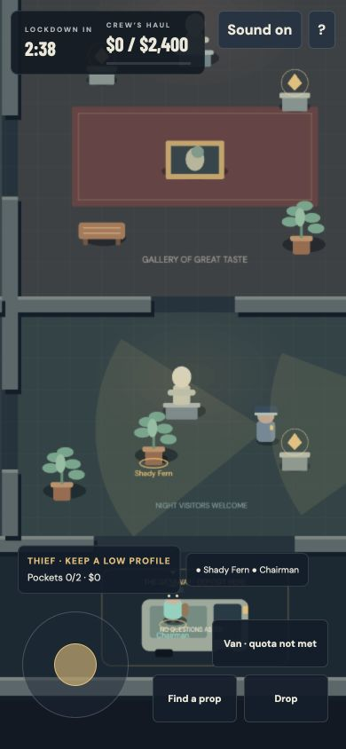

# 🎨 Bad Influence — *Petty Theft*

> A real-time, multiplayer cops-and-thieves museum heist for 2–6 players. No accounts. No downloads. Just vibes and very questionable art.

Built with **TypeScript**, **Phaser 3**, **Express**, and **Socket.IO**.

---

## Screenshots

<p align="center">
  
  
</p>
<p align="center">
  
</p>

---

## 🕹️ How to Play

### Competitive Mode (Default)
Players are secretly assigned roles each match:
- **Thieves** — steal art, rescue teammates, and escape in the van
- **Cops** — arrest thieves and prevent the getaway

**Thieves win** by depositing the displayed loot quota and extracting all free teammates.  
**Cops win** by capturing all thieves or waiting out the timer.

### Co-op Mode
All players are thieves working together against AI guards. Steal at least **\$2,400** in loot, then interact with the van to escape. All free, connected thieves must escape.

### Controls

| Action | Keyboard | Mobile |
|--------|----------|--------|
| Move | WASD / Arrow Keys | Virtual joystick |
| Interact / Inspect | E | Action button |
| Disguise / Transform | Q | Action button |
| Drop loot | R | Action button |
| Mute sound | — | Toggle in HUD |

### Tips
- 🪑 **Stay still** while disguised — moving builds suspicion
- 🖼️ **Paintings** (\$700) need two carriers but block disguises
- 🎷 Use the **gramophone** to distract guards (25-second cooldown)
- 🔒 Rescue captured teammates by holding still at the holding room lock for 3 seconds

---

## 🚀 Getting Started

Requires **Node.js 22+**

```sh
git clone https://github.com/KhushiBagga20/Bad-Influence.git
cd Bad-Influence
npm install
npm run dev
```

Open [http://localhost:3000](http://localhost:3000). Open **separate tabs** for each local player, pick a nickname, create a room, and share the 4-letter code.

---

## 🧪 Development Commands

```sh
npm run dev            # Start backend + Vite dev middleware together
npm run dev:frontend   # Standalone Vite (requires backend running on :3000)
npm run typecheck      # TypeScript validation
npm run build          # Type-check + production frontend bundle
npm test               # Authoritative simulation unit tests
npm run test:production  # Launch, test, and stop a production server
NODE_ENV=production npm start  # Serve dist + Socket.IO in production mode
```

---

## 🗂️ Project Structure

```
Bad-Influence/
├── frontend/                   Browser app (Phaser, Vite)
│   ├── src/
│   │   ├── game-client.ts      Renderer, screens, controls, socket client
│   │   └── styles.css          Responsive lobby, HUD & touch styles
│   ├── public/
│   │   └── how-to-play.html
│   └── vite.config.ts
├── backend/                    Authoritative multiplayer server
│   └── src/
│       ├── server.ts           HTTP, Socket.IO, rooms & simulation clock
│       ├── game-room.ts        Roles, movement, loot, arrests & outcomes
│       └── guard-navigation.ts NPC pathfinding for co-op mode
├── shared/
│   └── world.ts                Maps, collision, line-of-sight, types & constants
├── tests/
│   ├── backend/                Simulation regression tests
│   └── integration/            Real Socket.IO client integration tests
├── docs/
│   ├── GAMEPLAY.md             Full rules & implementation notes
│   ├── VALIDATION.md           Verification records
│   └── screenshots/
├── Dockerfile                  Combined production container
├── render.yaml                 Render.com backend blueprint
├── vercel.json                 Vercel frontend config
└── .env.example                Environment variable reference
```

---

## 🌐 Deployment

### Frontend → Vercel
1. Import this repo into [Vercel](https://vercel.com)
2. Set root as the project root; `vercel.json` configures the build
3. Add env variable: `VITE_SERVER_URL=https://YOUR_BACKEND_HOST`
4. Deploy

### Backend → Render / Docker
- Use `render.yaml` for a one-click Render deploy
- Or build and run the `Dockerfile` on any persistent Node host
- Set `CLIENT_ORIGIN=https://your-vercel-app.vercel.app`
- Requires a **single, always-on replica** (Vercel Functions cannot host this)

> ⚠️ The backend holds all room state in memory. Restarts end all active games. Horizontal scaling requires shared state design — a Redis adapter alone is not sufficient.

### Environment Variables

See [`.env.example`](.env.example) for all configuration options.

| Variable | Where | Description |
|----------|-------|-------------|
| `PORT` | Backend | Server port (default: 3000) |
| `CLIENT_ORIGIN` | Backend | Allowed CORS origin for frontend |
| `VITE_SERVER_URL` | Frontend build | Backend WebSocket URL |
| `NODE_ENV` | Backend | Set to `production` for static serving |

---

## 🏗️ Architecture

- **Authoritative server** runs a 30 Hz simulation loop; clients send intents, never trusted positions
- **15 Hz snapshots** broadcast game state to all connected clients
- **Phaser 3** renders the client with interpolation and visual prediction (≤100 ms)
- **Reconnect tokens** in session storage restore player identity after page reload
- **Socket.IO rooms** isolate multiplayer sessions; up to 500 concurrent rooms

---

## 📋 Scope & Known Limitations

This is a small, playable first version — not a production-scale service.

- ✅ Competitive (cops vs thieves) and co-op modes
- ✅ 3 museum map variants, procedural art, touch controls
- ✅ Rescue, disguise, loot, extraction, rematches
- ⚠️ No matchmaking, accounts, or moderation
- ⚠️ High-latency connections may feel delayed (no full rollback prediction)
- ⚠️ Touch controls need broader physical-device testing
- ⚠️ No persistent room/score storage

---

## 📄 License

Private project — all rights reserved.
